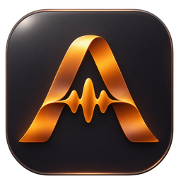
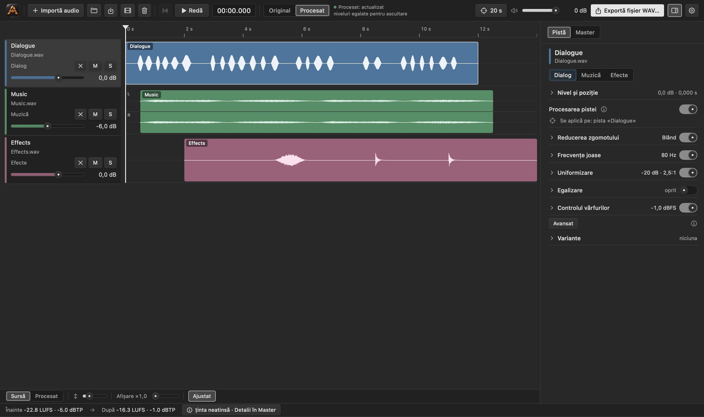

<h1 align="center">AFON</h1>

<b>Audio preparation and mixing for video on macOS, with a DaVinci Resolve Studio workflow integration.</b> 
Website: <a href="https://gordas.dev/afon/">https://gordas.dev/afon/</a>

<a href="#english">English</a> · <a href="#română">Română</a> · <a href="#español">Español</a>

Real capture of the AFON 0.6.0 window (interface shown in Romanian; the app is also available in English and Spanish). The tracks are synthetic demo files.

---

## English

**Download:** AFON 0.6.1 for Mac — [gordas.dev/afon](https://gordas.dev/afon/) (also attached to the [latest release](../../releases/latest)). A full 5-day trial with every feature is requested from inside the app; once approved, the 5 days start at the first activation, once per computer. Continued use is requested from the app as well.

This repository contains the public presentation, documentation and distribution of AFON. The application source code is proprietary and is not published here.

### What AFON does

AFON prepares and mixes the sound of a video on your Mac. You import dialogue, music and effects, clean and even out each track, balance the mix and export a WAV file — or send the result back to a DaVinci Resolve timeline.

- **Track processing** — background noise reduction (runs locally, no network), low-frequency cut, level evening, equalization and peak control, each with its own switch.
- **Master** — music lowered under speech, balance between roles, loudness of the exported mix (LUFS) and a true-peak ceiling (dBTP), with the measured result shown.
- **Fair comparison** — Original / Processed at matched levels, A/B variants per track, a 20-second preview from the cursor.
- **Reference video** — frame-accurate picture sync, docked or detached monitor, extraction of the video's sound as a track.
- **Formats** — WAV (PCM 16/24/32-bit or 32-bit float) and AIFF/AIFC; multichannel files up to 64 channels kept in sync; track fade-in / fade-out.
- **Export** — WAV with its measurement report and optional processed stems, written as a single all-or-nothing operation.
- **Languages** — interface and user manual in Romanian, English and Spanish.

Your original files are never modified.

### Workflow with DaVinci Resolve Studio

1. In Resolve, open **Workspace › Workflow Integrations › AFON** and send the timeline's edit to AFON.
2. In AFON, assign roles (Dialogue, Music, Effects), adjust track processing and the Master, and listen.
3. **Send to DaVinci Resolve** adds the result on new, synchronized tracks without touching the original tracks.
4. In Resolve, compare Original and AFON, restore listening states, or go back to a previous version of the result.

Not transferred from Resolve: level, pan, EQ, Fairlight processing, transitions and automation.

### What AFON is not

- Not a full DAW: no recording, clip cutting, automation or third-party plug-ins.
- No direct integration with Premiere Pro or Final Cut Pro (export audio → process in AFON → re-import the WAV).
- Loudness values are AFON settings, not universal delivery standards.

### Requirements

- macOS 27 (verified on macOS 27.0.1)
- Mac with Apple silicon (M1 or later)
- DaVinci Resolve Studio (verified with 21.2) on the same Mac for the integration (the app also works without Resolve)

### Support

Information, launch news and contact: [https://gordas.dev/afon/](https://gordas.dev/afon/)

---

## Română

**Descărcare:** AFON 0.6.1 pentru Mac — [gordas.dev/afon](https://gordas.dev/afon/) (și în [ultimul release](../../releases/latest)). Proba completă de 5 zile, cu toate funcțiile, se cere din aplicație; după aprobare, cele 5 zile încep la prima activare, o singură dată pe calculator. Continuarea se cere tot din aplicație.

Acest repository conține prezentarea publică, documentația și distribuția AFON. Codul sursă al aplicației este proprietar și nu este publicat aici.

### Ce face AFON

AFON pregătește și mixează sunetul unui video pe Mac. Imporți dialogul, muzica și efectele, cureți și uniformizezi fiecare pistă, echilibrezi mixul și exporți un fișier WAV — sau trimiți rezultatul înapoi într-o cronologie DaVinci Resolve.

- **Procesare pe pistă** — reducerea zgomotului de fond (local, fără rețea), frecvențe joase, uniformizare, egalizare și controlul vârfurilor, fiecare cu propriul comutator.
- **Master** — muzica scade sub voce, echilibru între roluri, loudness-ul mixului exportat (LUFS) și plafon de vârf (dBTP), cu rezultatul măsurat afișat.
- **Comparare cinstită** — Original / Procesat la niveluri egalate, variante A/B pe pistă, previzualizare de 20 s de la cursor.
- **Video de referință** — sincron la cadru, monitor integrat sau detașat, extragerea sunetului video ca pistă.
- **Formate** — WAV (PCM 16/24/32 sau float 32) și AIFF/AIFC; fișiere multicanal până la 64 de canale; fade-in / fade-out pe pistă.
- **Export** — WAV cu raportul de măsurători și, opțional, stem-urile procesate, scrise ca o singură operație „totul sau nimic”.
- **Limbi** — interfață și manual în română, engleză și spaniolă.

Fișierele tale originale nu sunt modificate niciodată.

### Fluxul cu DaVinci Resolve Studio

1. În Resolve deschizi **Workspace › Workflow Integrations › AFON** și trimiți montajul cronologiei în AFON.
2. În AFON atribui rolurile (Dialog, Muzică, Efecte), reglezi procesarea și Master-ul și asculți.
3. **Trimite în DaVinci Resolve** adaugă rezultatul pe piste noi, sincron, fără să atingă pistele originale.
4. În Resolve compari Original și AFON, restabilești stările de ascultare sau revii la o variantă anterioară a rezultatului.

Nu se preiau din Resolve: nivelul, panoramarea, EQ, procesarea Fairlight, tranzițiile și automatizările.

### Cerințe

- macOS 27 (verificat pe macOS 27.0.1)
- Mac cu Apple silicon (M1 sau mai nou)
- DaVinci Resolve Studio (verificat cu 21.2) pe același Mac pentru integrare (aplicația funcționează și fără Resolve)

### Suport

Informații, noutăți despre lansare și contact: [https://gordas.dev/afon/](https://gordas.dev/afon/)

---

## Español

**Descarga:** AFON 0.6.1 para Mac — [gordas.dev/afon](https://gordas.dev/afon/) (también en la [última versión publicada](../../releases/latest)). La prueba completa de 5 días con todas las funciones se solicita desde la app; tras la aprobación, los 5 días empiezan en la primera activación, una sola vez por ordenador. La continuación también se pide desde la app.

Este repositorio contiene la presentación pública, la documentación y la distribución de AFON. El código fuente de la aplicación es propietario y no se publica aquí.

### Qué hace AFON

AFON prepara y mezcla el sonido de un vídeo en tu Mac. Importas diálogo, música y efectos, limpias y nivelas cada pista, equilibras la mezcla y exportas un archivo WAV — o devuelves el resultado a una línea de tiempo de DaVinci Resolve.

- **Procesado por pista** — reducción del ruido de fondo (local, sin red), corte de graves, nivelación, ecualización y control de picos, cada uno con su interruptor.
- **Máster** — la música baja bajo la voz, equilibrio entre roles, sonoridad de la mezcla exportada (LUFS) y techo de pico real (dBTP), con el resultado medido a la vista.
- **Comparación honesta** — Original / Procesado con niveles igualados, variantes A/B por pista, vista previa de 20 s desde el cursor.
- **Vídeo de referencia** — sincronización al fotograma, monitor integrado o separado, extracción del sonido del vídeo como pista.
- **Formatos** — WAV (PCM 16/24/32 o float 32) y AIFF/AIFC; archivos multicanal de hasta 64 canales; fundidos de entrada / salida por pista.
- **Exportación** — WAV con su informe de mediciones y, opcionalmente, los stems procesados, escritos como una sola operación «todo o nada».
- **Idiomas** — interfaz y manual en rumano, inglés y español.

Tus archivos originales nunca se modifican.

### Requisitos

- macOS 27 (verificado en macOS 27.0.1)
- Mac con Apple silicon (M1 o posterior)
- DaVinci Resolve Studio (verificado con 21.2) en el mismo Mac para la integración (la app también funciona sin Resolve)

### Soporte

Información, novedades del lanzamiento y contacto: [https://gordas.dev/afon/](https://gordas.dev/afon/)

---

## Legal

AFON © Dumitru Cristinel Gordas (GDC). All rights reserved; see [LICENSE.txt](LICENSE.txt). Third-party components included in the application and their licences: [THIRD_PARTY_NOTICES.txt](THIRD_PARTY_NOTICES.txt).

AFON is an independent product. It is not developed, approved or supported by Blackmagic Design. DaVinci Resolve is a trademark of its owner.
